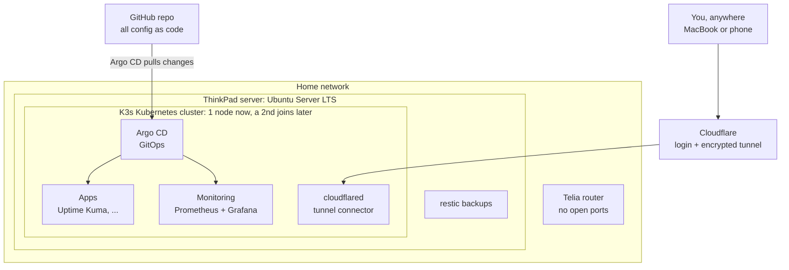

# Homelab: a Kubernetes platform on an old laptop

This repository documents and holds everything needed to turn an old Windows laptop into an always-on **Linux server running Kubernetes**, built entirely from code and reachable safely from anywhere.

It is written as a **learning journey**: I started with almost no Linux experience, and every step, command and mistake is written down so you can follow along from zero.

> **Status:** Phase 0–4 done (Ubuntu installed, connected from the MacBook, this repo, the server built with Ansible). Next: Phase 5, installing K3s.

> **Something broken?** Start at [Troubleshooting](docs/troubleshooting.md): find your symptom, follow the checks.

> **About this repo:** This is the **public** repository with my real configuration. Secrets are never committed: they stay out via `.gitignore`, or are encrypted with Sealed Secrets.

---

## What we are building

The goal is the **platform**, not any single app. Apps (and maybe a local AI agent later) are bonuses that run on top.

**My goal:** learn Kubernetes here, on real hardware, then move the platform to **Azure** (AKS).



**Key ideas**

- **Everything as code.** Server setup (Ansible), cluster (K3s, installed with Ansible), apps (Kubernetes manifests) and Cloudflare (OpenTofu) all live in this repo. If the server dies, it can be rebuilt from Git.
- **No open ports.** Remote access goes through an outbound Cloudflare Tunnel with a login in front, never port forwarding.
- **Free and open source.** The only costs are a domain name (about 100–150 kr a year) and electricity.

---

## The roadmap

```mermaid
flowchart LR
    p0["0 Prepare<br/>USB stick"]:::done
    p1["1 Install<br/>Ubuntu"]:::done
    p2["2 Connect<br/>from Mac"]:::done
    p3["3 Git repo"]:::done
    p4["4 Ansible"]:::done
    p5["5 K3s cluster"]:::now
    p6["6 First app"]:::todo
    p7["7 Argo CD"]:::todo
    p8["8 Sealed Secrets"]:::todo
    p9["9 Cloudflare"]:::todo
    p10["10 OpenTofu"]:::todo
    p11["11 Monitoring"]:::todo
    p12["12 Backups"]:::todo
    p13["13 CI"]:::todo
    p14["14 Routine"]:::todo
    p15["15 Azure"]:::todo

    p0 --> p1 --> p2 --> p3 --> p4 --> p5 --> p6 --> p7
    p7 --> p8 --> p9 --> p10 --> p11 --> p12 --> p13 --> p14 --> p15

    classDef done fill:#d4edda,stroke:#28a745,color:#155724
    classDef now fill:#fff3cd,stroke:#ffc107,color:#856404
    classDef todo fill:#f1f3f5,stroke:#adb5bd,color:#495057
```



Green = done, yellow = in progress, grey = not started.

---

## Guides

Start with the decisions, then follow the phases in order. **Guide numbers match the phase numbers in the roadmap.** Each guide follows the same pattern: **goal → steps → what each command does → how to check it worked (Done when) → problems I hit → video notes**.

| Phase | Guide | What you learn |
| --- | --- | --- |
| – | [Decisions: what we build and why](docs/decisions.md) | Why Ubuntu, K3s, Cloudflare, platform-first; every tool in one line |
| 0 | [Prepare the USB stick](docs/00-prepare-usb.md) | Download Ubuntu, write it to a USB stick from a Mac |
| 1 | [Install Ubuntu Server](docs/01-install-ubuntu.md) | BIOS, every installer screen, first login, growing the disk |
| 2 | [Network, SSH and running headless](docs/02-network-and-ssh.md) | Wi-Fi with netplan, SSH keys, laptop lid, mesh vs main router, fixed IP |
| 3 | [A Git repo for everything](docs/03-git-repo.md) | The repo structure, `.gitignore`, `CLAUDE.md`, going public safely |
| 4 | [My server, built from code with Ansible](docs/04-ansible.md) | Ansible basics, dry runs, handlers, loops, SSH hardening, firewall and IP ranges, the slow-boot fix |
| A | [Mock interview: Stage A](docs/interview-stage-a.md) | 5 interview questions on Phases 0–4, with model answers and every command explained |
| – | [Troubleshooting](docs/troubleshooting.md) | Something's wrong? Find the symptom, follow the checks, plus a command cheat sheet |
| – | [Pitfalls and fixes](docs/pitfalls.md) | Every mistake and surprise so far, a troubleshooting flowchart, golden rules |

Screenshots live in [`docs/images/`](docs/images/README.md), with secrets blurred.

---

## The hardware

| Part | What it is | What it means |
| --- | --- | --- |
| Computer | Lenovo ThinkPad T480s (old Windows laptop) | Quiet, low power, battery works as a built-in UPS |
| CPU | Intel Core i5-8350U, 4 cores / 8 threads | Plenty for a homelab |
| RAM | 8 GB, soldered, plus one free slot (max 24 GB) | The main limit; a 16 GB stick is the best upgrade |
| Disk | 256 GB NVMe SSD | Enough to start |
| GPU | Intel UHD 620 (built in), no NVIDIA | A local LLM is not realistic on this machine |
| Network | Wi-Fi to the main router for now; Ethernet later | |
| Second node | Planned: another computer joins as a K3s worker | A real multi-node cluster |

The day-to-day work happens from a **MacBook** over SSH. The server has no desktop and its lid stays closed.

---

## Conventions used in the guides

- Every command says **where it runs**:
  - **Mac**: the prompt ends with `%`, for example `alan@MacBook-Pro ~ %`
  - **Server**: the prompt ends with `$`, for example `user@homelab:~$`
- Placeholders in `<ANGLE_BRACKETS>` are replaced with your own values:

| Placeholder | Meaning | Example |
| --- | --- | --- |
| `<SERVER_IP>` | Fixed home-network address of the server | `192.168.1.193` |
| `<LAN_CIDR>` | The home network range | `192.168.1.0/24` |
| `<USER>` | Your Linux username on the server | `alan` |
| `<WIFI_NAME>` | The Wi-Fi network the server joins | `Telia-XXXXXX` |

- **Never** commit or show passwords, keys, tokens, your public IP address or router stickers. Blur them in screenshots and videos.

---

## Repository layout

```
homelab/
├── README.md           ← you are here
├── CLAUDE.md           ← context for Claude (how I work, current state)
├── LICENSE             ← MIT
├── docs/               ← the step-by-step guides (NN = phase number)
│   ├── decisions.md
│   ├── 00-prepare-usb.md, 01-install-ubuntu.md, 02-network-and-ssh.md, ...
│   ├── pitfalls.md
│   └── images/         ← screenshots, secrets blurred
├── ansible/            ← server configuration and K3s install (Phases 4–5)
├── bootstrap/          ← the one Argo CD app applied by hand (Phase 7)
├── argocd-apps/        ← one Argo CD Application per app
├── apps/               ← Kubernetes manifests for apps
├── infra/              ← platform parts: cloudflared, monitoring
├── terraform/          ← Cloudflare as code with OpenTofu (Phase 10)
└── .github/workflows/  ← CI checks (Phase 13)
```
