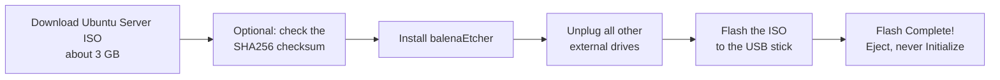

# Phase 0 · Prepare the USB stick (from a Mac)

**Goal:** a USB stick that can boot the old Windows laptop into the Ubuntu Server installer.

[← Decisions](decisions.md) · [Next: Phase 1, Install Ubuntu Server →](01-install-ubuntu.md)

---

## What you need

- A USB stick of **8 GB or more** (16 GB used here). Everything on it will be erased.
- A Mac (or any computer) with internet.
- About 20–30 minutes, mostly waiting for the download.

> **Why not Rufus?** Many guides use Rufus, but Rufus only runs on Windows. On a Mac, **balenaEtcher** does the same job.



---

## Step 1 · Download Ubuntu Server

1. Go to **ubuntu.com/download/server**.
2. Download **Ubuntu Server 26.04.1 LTS** (Server, not Desktop).
3. The file is `ubuntu-26.04.1-live-server-amd64.iso`, about 3 GB, in **Downloads**.

> **"amd64" on an Apple Silicon Mac?** Yes, that's right. The image is for the **laptop** you will install on (an Intel PC), not for the Mac.

### Optional: check the download isn't damaged

**Mac:**

```bash
shasum -a 256 ~/Downloads/ubuntu-26.04.1-live-server-amd64.iso
```

- `shasum -a 256` calculates a SHA-256 "fingerprint" of the file.
- Compare it with the matching line at `releases.ubuntu.com/26.04/SHA256SUMS`. Same value means the file is perfect.

---

## Step 2 · Install balenaEtcher

1. Go to **etcher.balena.io** and download the macOS version:
   - **Apple Silicon (arm64)** for M1/M2/M3/M4 Macs
   - **Intel (x64)** for older Macs ( → About This Mac tells you which)
2. Open the `.dmg` and drag **balenaEtcher** into **Applications**.
3. Open it. When macOS warns it was downloaded from the internet, click **Open**.

---

## Step 3 · Write Ubuntu to the stick

1. **Unplug every other external drive** first. This makes it impossible to erase the wrong disk.
2. Plug in the USB stick.
3. In Etcher:
   - **Flash from file** → the Ubuntu `.iso`
   - **Select target** → the USB stick (check that the size matches, about 14–16 GB)
   - **Flash!** → type your Mac password
4. Wait for writing and verifying, about 5–10 minutes, until **Flash Complete!**
5. If macOS says *"The disk you inserted was not readable by this computer"*, click **Ignore** or **Eject**. **Never click Initialize**: that would erase what Etcher just wrote. The Mac simply can't read the Linux format.
6. Close Etcher and pull out the stick.

---

## Things you don't need to do

- **Back up the Windows laptop** if, like me, you want nothing from it. The installer erases everything.
- **Log in to Windows.** It doesn't matter if you can't (for example, a forgotten password). Booting from the USB stick skips Windows entirely.
- **Check the hardware in Windows' Task Manager.** Ubuntu shows the same information after installation (see [Phase 1](01-install-ubuntu.md)).

---

**Done when:** Etcher shows *Flash Complete!* and the stick is ejected.

---

## Problems I hit

- **Rufus wouldn't work:** every guide said Rufus, but it only runs on Windows and I did all prep on my Mac. → balenaEtcher instead.
- **Almost used the wrong disk:** I wanted to put the installer on a 1 TB disk that had someone else's files on it. Writing an installer **erases the whole drive**. → a cheap 16 GB USB stick, and every other drive unplugged.
- **"The disk is not readable":** macOS complained about the finished stick. → click Ignore or Eject, never Initialize.
- **Couldn't log in to Windows:** no password for the old Windows. → not needed; booting from USB skips Windows.

More details: [Pitfalls → Preparing](pitfalls.md#preparing)

---

## Video notes

- **Episode idea:** "Turning an old Windows laptop into a server: the plan and the USB stick"
- **Show:** the plan (why Kubernetes, why platform first), downloading Ubuntu, balenaEtcher on the Mac
- **Hook:** "This old laptop is about to become a Kubernetes server."
- **Blur:** nothing special here, just don't show other drives' names if they're personal
