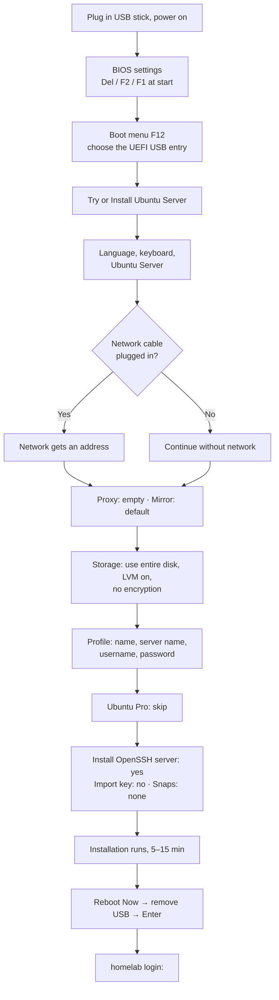

# Phase 1 · Install Ubuntu Server

**Goal:** erase Windows, install Ubuntu Server, log in, and give the system the disk space it needs.

[← Phase 0, Prepare the USB stick](00-prepare-usb.md) · [Next: Phase 2, Network and SSH →](02-network-and-ssh.md)

---

## The whole install at a glance



---

## Step 1 · BIOS settings

Power on and press the BIOS key straight away (on a ThinkPad usually **F1**, on many PCs **Del** or **F2**).

| Setting | Value | Why |
| --- | --- | --- |
| Secure Boot | **Disabled** | Avoids extra steps for drivers later |
| SATA mode (if present) | **AHCI** | Otherwise the installer may not see the disk |
| Restore on AC power loss (if present) | **Power On** | The server starts again after a power cut |
| Fast Boot | **Disabled** | Makes the boot menu reachable |

Save and exit (usually **F10**).

## Step 2 · Boot from the USB stick

Restart and press the **boot menu key** (usually **F12**). Choose the USB entry starting with **UEFI**, then **Try or Install Ubuntu Server**.

## Step 3 · The installer, screen by screen

| Screen | What I chose | Notes |
| --- | --- | --- |
| Language | English | The installer is easiest in English |
| Keyboard | Swedish | Match your physical keyboard |
| Type of install | **Ubuntu Server** (not minimized) | |
| Network | No cable → **Continue without network** | Works fine; Wi-Fi is set up after install ([Phase 2](02-network-and-ssh.md)) |
| Proxy | **Leave empty** | Only needed on some company or school networks |
| Mirror | **Keep the default** | The server Ubuntu downloads updates from. Without network it installs from the USB stick |
| Storage | **Use an entire disk** · **LVM on** · **Encryption off** | See below |
| Profile | Name, server name `homelab`, a lowercase username, a strong password | Save the password in a password manager |
| Ubuntu Pro | **Skip for now** | Free for personal use; can be added later with `sudo pro attach` |
| SSH | **Install OpenSSH server: yes** · Import SSH key: no · Allow password auth: yes | You need one password login to copy your key later |
| Featured snaps | **None** | Docker is installed later by Ansible, not as a snap |

### About the storage screen

- The disk showed as **238G**: that's a 256 GB SSD (disks are sold in decimal GB, Linux shows binary GiB).
- **LVM** (Logical Volume Manager) makes the disk flexible: think of the disk as a cabinet (*volume group* `ubuntu-vg`) with drawers (*logical volumes*, like `ubuntu-lv`) whose size can change later.
- **Don't encrypt with LUKS** on an always-on server: after every reboot or power cut it would stop and wait for someone to type a password at the keyboard.
- Confirming the summary **erases Windows**. That's the point of no return.

## Step 4 · Reboot

1. When **Reboot Now** appears at the bottom, the installation is finished. The heading doesn't always say "complete".
2. When it says *"Please remove the installation medium, then press ENTER"*, pull out the stick, then press **Enter**.
3. The first start can be slow. A line like *"A start job is running for Wait for Network to be Configured"* is normal when there's no cable.
4. You'll reach `homelab login:`. Type your username, then your password (nothing shows while you type it).

---

## Step 5 · First look around

**Server:**

```bash
whoami    # which user am I?         → your username
pwd       # which folder am I in?    → /home/<USER>
```

How to read the prompt `alan@homelab:~$`:

| Part | Meaning |
| --- | --- |
| `alan` | your user |
| `@homelab` | the computer's name |
| `~` | your home folder, `/home/alan` |
| `$` | normal user (root would show `#`) |

Linux has no `C:` drive. Everything starts at `/`:

| Folder | What lives there |
| --- | --- |
| `/home/<USER>` | your files |
| `/etc` | system settings (network, SSH, firewall) |
| `/var/log` | log files |
| `/srv` | data for services (the cluster data goes here later) |

> **`sudo`** in front of a command means "run this as administrator". It asks for your password.

---

## Step 6 · Give the system more disk space

The installer gives the system at most about **100G** and leaves the rest of the disk free **on purpose**, so you can decide later how to use it (more space, a separate data volume, or LVM snapshots).

**Server:** see the current size and the free space.

```bash
df -h /       # "disk free", human-readable, for the root filesystem
sudo vgs      # the volume group: total size (VSize) and unused space (VFree)
sudo lvs      # the logical volumes and their sizes
```

> **Where does the name `/dev/ubuntu-vg/ubuntu-lv` come from?** The Ubuntu installer always uses these names. `sudo lvs` shows them (columns `LV` and `VG`), and LVM devices always appear as `/dev/<VG>/<LV>`. In `df` you'll see the same volume as `/dev/mapper/ubuntu--vg-ubuntu--lv`: the device mapper doubles each real dash.

**Server:** grow the volume. I added 80G and kept about 58G free for later:

```bash
sudo lvextend -r -L +80G /dev/ubuntu-vg/ubuntu-lv
```

| Part | Meaning |
| --- | --- |
| `lvextend` | make a logical volume bigger |
| `-L +80G` | add exactly 80 GB (`-l +100%FREE` would add all free space instead) |
| `-r` | also resize the filesystem inside, so the space can be used |

Then `df -h /` showed **177G**.

> Growing is easy and safe, even while running. **Shrinking is hard and risky**, so grow in steps if you're unsure.

---

## Step 7 · What hardware do I have?

**Server:** these commands only show information and change nothing.

```bash
lscpu | grep -E 'Model name|^CPU\(s\)'    # CPU model and number of CPUs
free -h                                   # memory
lsblk                                     # disks, as a tree
lspci | grep -iE 'vga|3d|nvidia'          # graphics card
sudo dmidecode -s system-product-name     # the computer's model number
sudo dmidecode -t memory | grep -E 'Size:|Locator:'   # memory slots
```

> **The pipe `|`** sends the output of one command into the next. `grep` keeps only matching lines. On a Swedish Mac keyboard `|` is **Option + 7**.

What mine showed:

| Result | Meaning |
| --- | --- |
| Intel Core i5-8350U, 8 CPUs, 4 cores per socket | 4 real cores, each running 2 tasks |
| 7.0 Gi memory | 8 GB, part reserved for built-in graphics |
| No NVIDIA in `lspci` | built-in Intel graphics only |
| Model `20L8...` | Lenovo ThinkPad T480s |
| One 8 GB entry in `ChannelA-DIMM0` | the soldered memory; the one free slot is empty (max total 24 GB) |

---

**Done when:** you can log in at `homelab login:`, the disk has been grown, and you know what hardware you have.

---

## Problems I hit

- **No Ethernet cable during the install:** the network screen found nothing. → *Continue without network*; Wi-Fi comes in Phase 2.
- **Unsure about the proxy, mirror and Ubuntu Pro screens:** → proxy empty, mirror default, Pro skipped.
- **No "Installation complete" heading:** only a *Reboot Now* button. → that button only appears when the install is done.
- **Only ~100G of a 238G disk was used:** I first thought something was wrong, then wondered if I should touch it at all. → it's a cautious default; I grew it by 80G and kept the rest free.
- **Where did `/dev/ubuntu-vg/ubuntu-lv` come from?** → `sudo lvs` and `lsblk` show it. Look before you run disk commands.
- **Weaker hardware than hoped:** 8 GB RAM and no NVIDIA GPU. → fine for the platform; the local AI agent waits.

More details: [Pitfalls → Installing](pitfalls.md#installing)

---

## Video notes

- **Episode idea:** "Goodbye Windows: installing Ubuntu Server"
- **Show:** the BIOS settings (film the screen with a phone, screen recorders can't run there), every installer screen and what I chose, the first login, growing the disk from 100G to 177G
- **Hook:** "One click and Windows is gone for good. Here's every screen of the Ubuntu Server installer."
- **Blur:** your password is never shown, but don't film the keyboard while typing it
