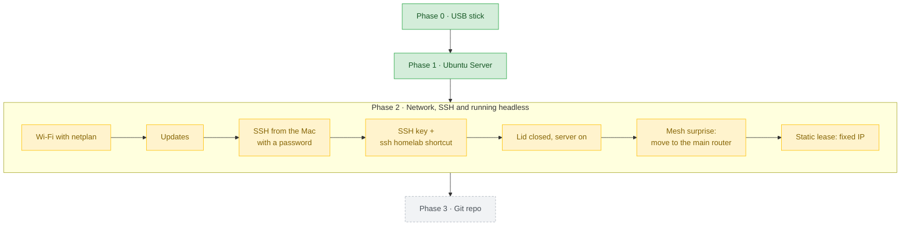
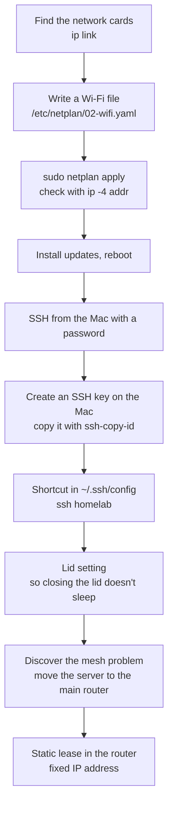
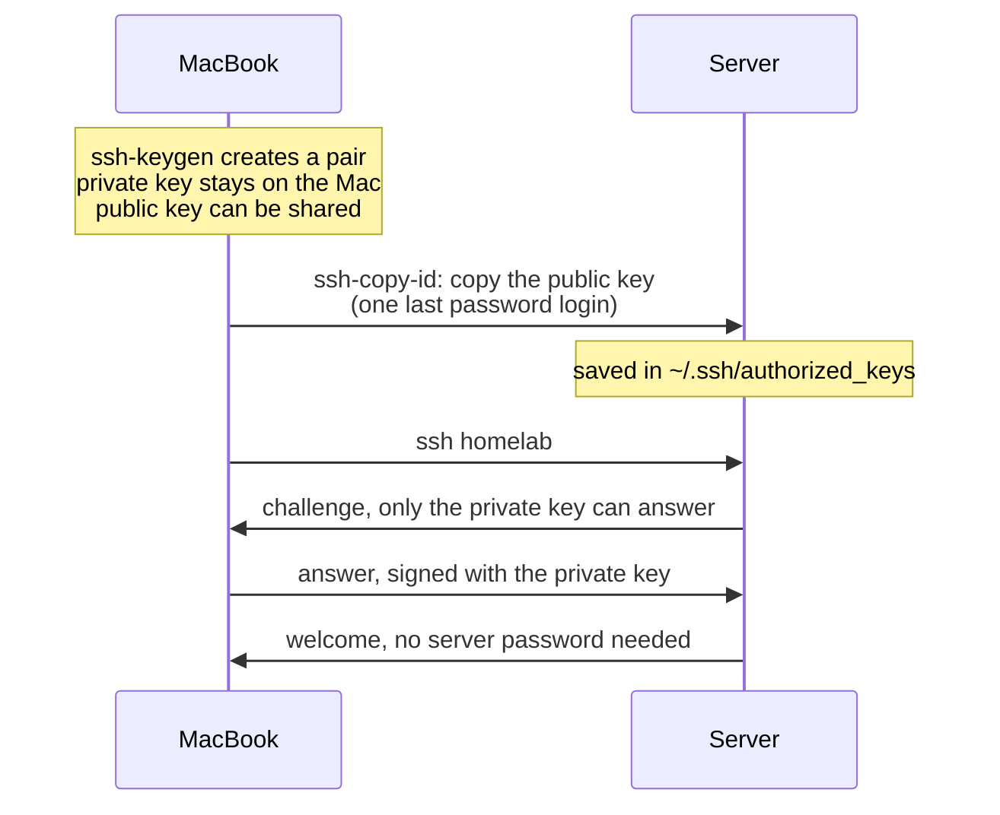
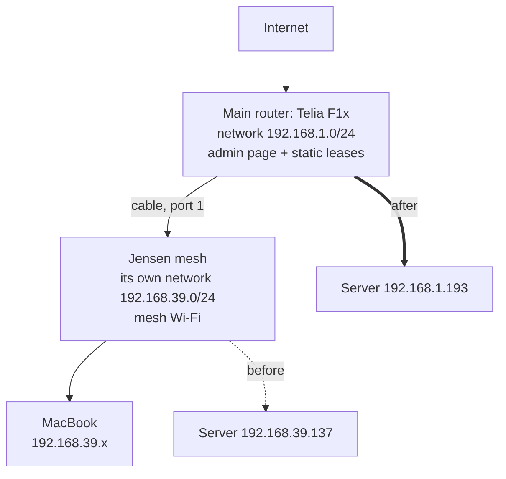

# Phase 2 · Network, SSH and running headless

**Goal:** get the server online over Wi-Fi, control it from the Mac with an SSH key, keep it running with the lid closed, and give it an address that never changes.

[← Phase 1, Install Ubuntu Server](01-install-ubuntu.md) · [Next: Phase 3, Git repo →](03-git-repo.md)


## The journey so far

Everything from the very start up to the end of this phase. Green = earlier phases, yellow = this phase, grey = what comes next.



---

## Overview



---

## Part 1 · Wi-Fi with netplan

### Find the network cards

**Server:**

```bash
ip link
```

| Name starts with | What it is |
| --- | --- |
| `lo` | loopback, the computer talking to itself (ignore) |
| `e...` (`enp0s31f6`, `eno1`) | the Ethernet port |
| `wl...` (`wlp61s0`) | the Wi-Fi card |

`state UP` means connected, `NO-CARRIER` means no cable. An `altname` is just a second name for the same card; use the main one.

### Write the Wi-Fi settings

Netplan reads every `.yaml` file in `/etc/netplan/` in number order and combines them. Leave the installer's `00-installer-config.yaml` alone and **create** a new file (it doesn't exist until you save it):

**Server:**

```bash
sudo vim /etc/netplan/02-wifi.yaml
```

In Vim: `:set paste` (so the indentation isn't changed), `i`, type the text, `Esc`, `:wq`.

```yaml
network:
  version: 2
  wifis:
    wlp61s0:                 # your Wi-Fi card's name from ip link
      dhcp4: true            # let the router hand out an address
      access-points:
        "<WIFI_NAME>":
          password: "<WIFI_PASSWORD>"
```

> **YAML is strict:** 2 spaces per level, never Tab. Names and passwords are case-sensitive.

### Activate and check

**Server:**

```bash
sudo chmod 600 /etc/netplan/02-wifi.yaml   # only root may read it (it holds a password)
sudo netplan apply                          # read all netplan files and activate them
ip -4 addr show wlp61s0                     # did we get an address?
ping -c 3 ubuntu.com                        # is the internet reachable?
```

**What `chmod 600` means:** three digits for owner, group, everyone else. Each digit adds 4 = read, 2 = write, 1 = execute. `6 0 0` = owner reads and writes, nobody else gets anything. `ls -l` shows it as `-rw-------`. A settings file never needs execute.

**Reading `ip -4 addr`:**

```
inet 192.168.1.193/24 metric 600 brd 192.168.1.255 scope global dynamic wlp61s0
     valid_lft 81516sec
```

| Part | Meaning |
| --- | --- |
| `inet 192.168.1.193` | the server's address on the home network |
| `/24` | the network size: everything starting `192.168.1.` |
| `metric 600` | priority; lower wins (a cable gets 100, so it's preferred) |
| `brd ...255` | broadcast address, "everyone on the network" |
| `dynamic` | handed out by the router (DHCP) |
| `valid_lft` | seconds until it's renewed, automatically |

### Install updates

**Server:**

```bash
sudo apt update && sudo apt full-upgrade -y && sudo reboot
```

| Part | Meaning |
| --- | --- |
| `apt update` | refresh the list of available packages |
| `apt full-upgrade -y` | install all updates, answering "yes" automatically |
| `reboot` | restart, needed for kernel updates |
| `&&` | run the next command only if the previous succeeded |

---

## Part 2 · SSH from the Mac

**Mac vs server: check the prompt before every command.** `... %` is the Mac (zsh), `...$` is the server (bash). Linux commands like `ip` don't exist on the Mac: `zsh: command not found: ip` means you typed it on the wrong machine.

### First login with a password

**Mac:**

```bash
ssh <USER>@<SERVER_IP>
```

The first time it asks *"Are you sure you want to continue connecting?"*. Type `yes`: the Mac saves the server's fingerprint in `~/.ssh/known_hosts`. `exit` takes you back to the Mac.

### How SSH keys work



Think of the **public key as a lock** you can put on many doors, and the **private key as the only key** that opens them. Never copy a private key to another computer: each computer gets its own key.

### Check what's already there

**Mac:**

```bash
ls -la ~/.ssh
cat ~/.ssh/config
```

> **Don't delete old keys blindly.** My `~/.ssh` held keys from earlier projects, and my `config` pointed to keys that no longer existed. Find out where a key is used, add the new key there, test it, and only then delete the old one.

### Create one key for this Mac

**Mac:**

```bash
ssh-keygen -t ed25519 -C "alan-macbook"
```

| Part | Meaning |
| --- | --- |
| `-t ed25519` | modern, recommended key type |
| `-C "alan-macbook"` | a label, so wherever the key is installed you can see it came from this MacBook |

Press **Enter** for the default file (`~/.ssh/id_ed25519`), then choose a **passphrase** and save it in a password manager.

### Copy the key to the server and test

**Mac:**

```bash
ssh-copy-id -i ~/.ssh/id_ed25519.pub <USER>@<SERVER_IP>
ssh -i ~/.ssh/id_ed25519 <USER>@<SERVER_IP>
```

If it asks *"Enter passphrase for key ..."* the key is working. If it asks for *"...'s password"* the key wasn't accepted.

### A shortcut: `ssh homelab`

**Mac:** add at the end of `~/.ssh/config` (in Vim: `G` to jump to the end, `o` for a new line):

```
Host homelab
  HostName <SERVER_IP>
  User <USER>
  IdentityFile ~/.ssh/id_ed25519
  AddKeysToAgent yes
  UseKeychain yes
```

| Line | Meaning |
| --- | --- |
| `Host homelab` | the short name you type |
| `HostName` | the real address |
| `User` | who to log in as |
| `IdentityFile` | which private key to use |
| `AddKeysToAgent yes` | remember the unlocked key while the Mac runs |
| `UseKeychain yes` | (Mac only) store the passphrase in the macOS Keychain |

Now `ssh homelab` is all you type.

> **OrbStack users:** a line `Include ~/.orbstack/ssh/config` at the top of the config is OrbStack's own setup. Leave it alone; it doesn't affect the homelab.

---

## Part 3 · Keep a laptop running with the lid closed

By default a laptop sleeps when its lid closes, which takes the server offline.

**Server:**

```bash
sudo mkdir -p /etc/systemd/logind.conf.d
sudo vim /etc/systemd/logind.conf.d/lid.conf
```

```ini
[Login]
HandleLidSwitch=ignore
HandleLidSwitchExternalPower=ignore
HandleLidSwitchDocked=ignore
```

- **logind** is the part of systemd that handles logins, power buttons and the lid.
- A `.conf.d` folder holds extra settings files, so updates never overwrite your change.
- The three lines cover battery, charger and docking station.

**Server:** check it, then activate it:

```bash
cat /etc/systemd/logind.conf.d/lid.conf    # check spelling! typos are silently ignored
sudo systemctl restart systemd-logind      # reload the settings (may log you out)
```

Test: close the lid, wait 30 seconds, then from the Mac run `ssh homelab` and `uptime`.

```
12:34:01 up  2:31,  2 users,  load average: 0.02, 0.05, 0.00
```

| Part | Meaning |
| --- | --- |
| `12:34:01` | server clock (UTC by default, one hour behind Sweden in winter) |
| `up 2:31` | running without a break, so it never slept |
| `2 users` | logged-in sessions |
| `load average` | how busy the CPU was over 1, 5 and 15 minutes (under 8 = spare capacity on 8 CPUs) |

**Laptop-server tips:** keep the charger plugged in, give it air on a hard surface, and enjoy the battery as a built-in UPS.

---

## Part 4 · The mesh-network surprise

To give the server a fixed address I needed the router's admin page. That uncovered how my home network is really built.

### Detective work

**Server:**

```bash
ip route show default         # where does traffic to the internet go?
# default via 192.168.39.1 dev wlp61s0 ...   → the "router" is 192.168.39.1

ip neigh show 192.168.39.1    # what hardware is at that address?
# ... lladdr 34:21:09:xx:xx:xx STALE
```

The first half of a MAC address (`34:21:09`) identifies the **manufacturer**. A MAC-lookup website showed Jensen Scandinavia: the **mesh Wi-Fi unit**, not the internet router. Its web page refused connections (`ERR_CONNECTION_REFUSED`) and its sticker had no admin login.

### What the network actually looked like



The mesh ran a **separate network inside** the main one (a "double NAT"). The fix: connect the server **directly to the main router**.

- Mac → server still works from the mesh Wi-Fi: the mesh passes traffic up to the main router.
- Server → Mac does not, but that's never needed.

### Moving the server to the main router's Wi-Fi

1. On the router sticker: the **Wi-Fi name and password** (box on the right) and the **web admin address, username and password** (bottom left). Never show these on video or in Git.
2. **Mac:** open the admin page (`http://teliagateway.lan`, or the gateway IP), log in, and look at the **Wireless** tile to confirm the router's own Wi-Fi is on.
3. **Server:** edit `/etc/netplan/02-wifi.yaml` and change the network name and password.
4. **Server:** `sudo netplan apply`. The SSH session **freezes**: the server just left the network you were connected through. Press **Enter, `~`, `.`** to close a frozen SSH session.
5. **Mac:** in the router's **Devices** tile, find `homelab` (or the Wi-Fi card's MAC address) and note its **new IP address**.
6. **Mac:** update `HostName` in `~/.ssh/config` (in Vim: `:s/old-ip/new-ip/`) and test `ssh homelab`.

> Keep the laptop within reach during step 4: if the name or password is wrong, the server can't join and you must fix the file at its own keyboard.

---

## Part 5 · A fixed IP address (static lease)

**Router admin page → Local Network → Static leases:** add

| Hostname | MAC address | IP |
| --- | --- | --- |
| `homelab` | the server's Wi-Fi MAC | `<SERVER_IP>` |

The router may warn *"IP already in use, please reboot"*. It's in use by the server itself. Instead of rebooting the router (internet down for the whole house), **reboot the server**: `sudo reboot`, wait 2 minutes, `ssh homelab`, and check `ip -4 addr show wlp61s0`.

> After a reboot you may see *"System is booting up. Unprivileged users are not permitted to log in yet"*. Startup isn't finished; wait and try again. On this laptop it took several minutes: the system waited for the unused Ethernet port. I tracked it down and fixed it in [Phase 4, Task 9](04-ansible.md#task-9--the-2-minute-boot-fixed).

---

## If you lose your SSH key

Losing the key doesn't lock you out forever. Password login is only switched off for **SSH** (Phase 4); the laptop's own keyboard still takes your password. **Whoever can touch the machine can always get in.**

1. Make a new key on the (new) Mac: `ssh-keygen -t ed25519 -C "alan-macbook"`
2. Open the lid, log in at the keyboard with your password
3. Temporarily allow passwords again by moving the hardening file away, then restart SSH:
   ```bash
   sudo mv /etc/ssh/sshd_config.d/10-hardening.conf /root/
   sudo systemctl restart ssh
   ```
4. From the Mac: `ssh-copy-id -i ~/.ssh/id_ed25519.pub <USER>@<SERVER_IP>`, then test `ssh homelab`
5. Run the Ansible playbook -> it notices the hardening file is missing, puts it back and restarts SSH. Passwords are off again.

**Better: don't get there.** Keep a copy of the private key in your password manager (it's encrypted with your passphrase), add a second key from another computer, and keep the server password safe.

---

**Done when:** `ssh homelab` works from the Mac with your key, the lid is closed, and the server keeps the same IP after a reboot.

| Value | Mine |
| --- | --- |
| `<SERVER_IP>` | `192.168.1.193` |
| `<LAN_CIDR>` | `192.168.1.0/24` |
| Router (gateway) | `192.168.1.1` |

---

## Problems I hit

- **Didn't know the Wi-Fi password:** → the Mac remembers it (System Settings → Wi-Fi → Details).
- **Guides used nano, I know Vim:** → any editor works; `:set paste` keeps YAML indentation intact.
- **`02-wifi.yaml` didn't exist:** → you create it; Vim makes the file when you save.
- **Typed Linux commands on the Mac:** `zsh: command not found: ip`. → check the prompt: `%` is the Mac, `$` the server.
- **Thought I'd cleaned `~/.ssh`, but hadn't:** old keys were still there, and my `config` pointed to keys that no longer existed. → look first, and only delete a key after its replacement works.
- **A typo in `lid.conf`** (`Swtich`) was silently ignored. → always `cat` a file after writing it.
- **The router wasn't the router:** `192.168.39.1` turned out to be the mesh unit, running its own network. → moved the server to the main router's Wi-Fi.
- **SSH froze when switching Wi-Fi:** → expected; `Enter ~ .` closes it, and the router's Devices list shows the new IP.
- **"IP already in use" when saving the static lease:** → it was the server itself; I rebooted the server, not the router.
- **Very slow boot afterwards:** "System is booting up" for several minutes. → the system waited for the unused Ethernet port; fixed in [Phase 4](04-ansible.md#task-9--the-2-minute-boot-fixed).

More details: [Pitfalls → Networking and SSH](pitfalls.md#networking-and-ssh), [Running a laptop as a server](pitfalls.md#running-a-laptop-as-a-server), [The home network](pitfalls.md#the-home-network)

---

## Video notes

- **Episode idea:** "My server has no screen: Wi-Fi, SSH keys, and a network detective story"
- **Show:** netplan on screen, the SSH key diagram, the lid test (close the lid, `uptime`), and the mesh detective work: `ip route` -> `ip neigh` -> MAC lookup -> "the router wasn't the router"
- **Hook:** "I couldn't find my own router's admin page. Turns out I was talking to the wrong box all along."
- **Blur:** router stickers (Wi-Fi and admin passwords), my public IP in the router page, the Wi-Fi password in `02-wifi.yaml`
