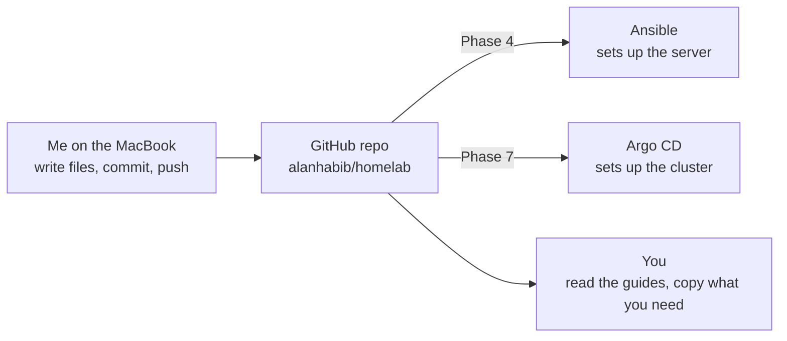

# Phase 3 · A Git repo for everything

**Goal:** one place where my whole homelab lives as files. Server setup, cluster, apps, docs: all of it in Git, so I can rebuild everything and so you can follow along.

[← Phase 2, Network and SSH](02-network-and-ssh.md) · [Next: Phase 4, Ansible →](04-ansible.md)

---

## Why a repo at all?

Up until now I set up the server by typing commands by hand. That works, but it lives in my head (and in a long chat history). If the disk dies, I have to remember everything again.

A Git repo fixes that:

- **History:** every change is saved, with when and why. I can always go back.
- **Backup:** GitHub keeps a copy online.
- **Source of truth:** later, Ansible (Phase 4) and Argo CD (Phase 7) read their instructions **from this repo**. The repo describes the homelab -> the tools make reality match it.



---

## Step 1 · Create the repo on GitHub

1. github.com -> **+** -> **New repository**
2. Name: `homelab`
3. I started with **Private**, and checked **Add a README**
4. No `.gitignore` template and no license yet (I made my own later)
5. Clone it to the Mac and work from there

I already knew Git, so this was quick. If you don't, any "Git basics" tutorial covers clone, add, commit and push. That's all you need here.

---

## Step 2 · The folder structure

I created the folders for all the coming phases up front, so I always know where things go:

```
homelab/
├── README.md        ← start page
├── CLAUDE.md        ← context for Claude (more below)
├── LICENSE          ← MIT
├── docs/            ← these guides, NN = phase number
├── ansible/         ← server setup (Phase 4) and K3s install (Phase 5)
├── apps/            ← my apps as Kubernetes files (Phase 6)
├── bootstrap/       ← the one Argo CD app I apply by hand (Phase 7)
├── argocd-apps/     ← one file per app for Argo CD (Phase 7)
├── infra/           ← platform parts: Cloudflare connector, monitoring
├── terraform/       ← Cloudflare as code with OpenTofu (Phase 10)
└── .github/workflows/ ← automatic checks (Phase 13)
```

**Good to know:** Git only tracks **files**, not folders. An empty folder never shows up on GitHub. Each one appears when its phase adds the first file.

```bash
mkdir -p ansible apps bootstrap argocd-apps infra terraform .github/workflows
```

`mkdir -p` -> make folders, `-p` -> also create parent folders (`.github` before `workflows`) and don't complain if one already exists.

---

## Step 3 · `.gitignore`: my safety net against leaking secrets

A `.gitignore` is a list of file names Git should **never** track. They don't show up in `git status` and can't be committed by accident. I added it **before** any of those files existed, so they're protected from day one.

```gitignore
# OpenTofu / Terraform: state and variables can contain secrets
.terraform/
*.tfstate
*.tfstate.*
*.tfvars

# Kubernetes access files and unencrypted secrets
kubeconfig*
*.unsealed.yaml
sealed-secrets-master-key.yaml

# Keys, just in case
*.pem
*.key
id_*

# Ansible leftovers and macOS clutter
*.retry
.DS_Store
.idea/
```

How to read it:

| Pattern | Means |
| --- | --- |
| `.DS_Store` | ignore any file with exactly this name, in any folder |
| `*.tfvars` | `*` = "anything" -> every file ending in `.tfvars` |
| `kubeconfig*` | everything **starting** with `kubeconfig` |
| `.terraform/` | a trailing `/` -> a whole folder |
| `# ...` | a comment for humans |

- `.DS_Store` -> a macOS file that remembers how a folder looks in Finder. Useless in a repo.
- `.idea/` -> settings from JetBrains editors (IntelliJ, WebStorm...). Mine, not the project's.

---

## Step 4 · `CLAUDE.md`: a briefing for my AI helper

I'm learning this with Claude as a tutor. `CLAUDE.md` is a file in the root of the repo that Claude Code reads automatically when it starts. It holds:

- **how I want to learn** (I write every file myself, one step at a time, simple words, examples)
- **my setup** (the server, the network, the IP addresses)
- **what's done**, the open issues, and the plan
- **the never-rules** (no secrets in Git, no open router ports)

So every new session starts where the last one stopped, instead of from zero.

---

## Step 5 · Going public

I decided to make the repo **public**, so you can follow the journey with my real, working files.

**What public means:**

| People can | People can't |
| --- | --- |
| read every file **and the whole history** | change anything in my repo (only I can push) |
| clone it, or fork it (their own copy) | touch my server: the repo is a description, not a remote control |
| suggest changes (issues, pull requests) | |

**Before switching to public, I scanned the repo** for passwords, keys, tokens and my home's public IP, in every file and in every old commit. Nothing was there, because placeholders like `<WIFI_PASSWORD>` and the `.gitignore` had done their job.

**What is visible, and is that OK?**

| Visible | Risk |
| --- | --- |
| Home addresses like `192.168.1.193` | none: these only work inside my home |
| The server's username | very low: SSH needs my key, and no ports are open to the internet |
| My email in old commits | low (spam). New commits use GitHub's private "noreply" address |

**My rule from now on:** before every commit, glance at `git diff --staged` for anything that looks like a password or token. Git history is forever.

### The MIT license

A license says what others may do with my files. **MIT** = use, copy and change freely, even commercially, as long as you keep my name and the license text, and there's no guarantee. I added it on GitHub: **Add file -> Create new file -> name it `LICENSE` -> Choose a license template -> MIT**.

---

## Done when

- The repo exists on GitHub, is public, has an MIT license
- `.gitignore`, `README.md`, `CLAUDE.md` and the docs are committed
- A scan finds no secrets, in the files or the history

---

## Problems I hit

- **`.DS_Store` got committed anyway.** It was in my very first commit, *before* `.gitignore` existed. A `.gitignore` only stops **new** files; files Git already tracks stay tracked. Fix -> `git rm --cached .DS_Store` (stop tracking it, keep it on disk), then commit.
- **`mv` refused to replace my `docs` folder:** `Directory not empty`. `mv` never overwrites a folder that has files in it, not even with `-f`. Fix -> `rm -r docs` first, then `mv`. Or `rsync -av --delete new/ docs/` to make one folder an exact copy of another (`--delete` removes files that no longer exist, the trailing `/` means "the contents of").
- **A JetBrains `.idea/` folder appeared** after opening the repo in IntelliJ. -> added to `.gitignore`.
- **The README said "private"** after I made the repo public. Remember to update the text, not just the setting.

More: [Pitfalls -> Git and the repo](pitfalls.md#git-and-the-repo)

---

## Video notes

- **Episode idea:** "My homelab is now code: the repo, and why I made it public"
- **Show:** the folder structure, `.gitignore` explained line by line, `CLAUDE.md` and how it helps me learn, the public/private switch and the secret scan
- **Hook:** "Everything in this video is public on GitHub, and I'll show you how I made sure no password ended up there."
- **Blur:** my email address in the commit list
