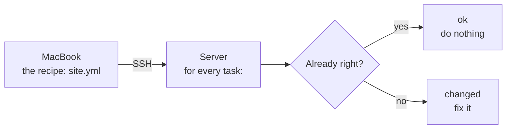
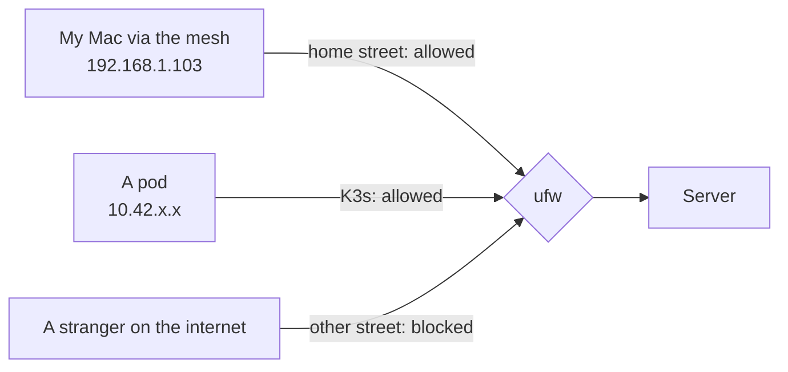
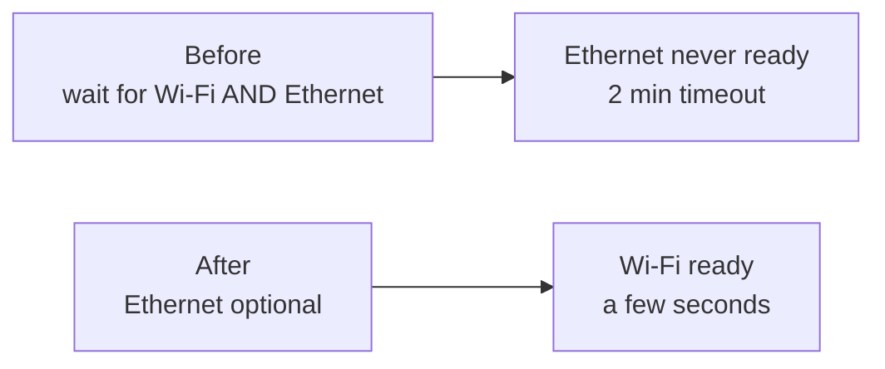

# Phase 4 · My server, built from code with Ansible

**Goal:** stop typing setup commands on the server by hand. Instead I describe how the server should look, in a file on my Mac, and Ansible makes the server match it. If the disk dies tomorrow -> reinstall Ubuntu, run one command, done.

Honestly, Ansible blew my mind. This is the phase where it clicked for me why people say "infrastructure as code".

[← Phase 3, Git repo](03-git-repo.md) · [Pitfalls and fixes →](pitfalls.md)

---

## Part 1 · What Ansible is (and what it replaces)

In Phase 2 I set up the server by logging in and typing, one command at a time: updates, the lid file, restarts. It worked, but nothing was written down.

**Ansible is a cook, and the playbook is the recipe.** I write the recipe on my Mac. Ansible logs in to the server over SSH and makes it so. Hand over the same recipe again -> you get the same dish.



### The big difference from a script

A script says **what to do** ("create this file, restart that"). Run it twice -> it does everything twice.

Ansible says **what should be true** ("this file should exist with this content"). Every run it **checks first**:

- already right -> **`ok`**, nothing happens
- missing or different -> fixes it -> **`changed`**

Run it once or a hundred times, same result. The fancy word is **idempotent**. That's why I can re-run my playbook any time, for example after updates, to put the server back the way it should be.

### Words you'll meet

| Word | Plain words | In my homelab |
| --- | --- | --- |
| **Control node** | the computer Ansible runs on | my Mac |
| **Managed node** | a computer Ansible sets up | the ThinkPad |
| **Inventory** | the list of servers | `inventory.ini` |
| **Playbook** | the recipe: a list of tasks | `site.yml` |
| **Task** | one thing that should be true | "the timezone is Swedish time" |
| **Module** | the tool a task uses | `apt` installs packages, `copy` writes files, `ufw` sets firewall rules |
| **Collection** | a bundle of modules you download | `community.general`, `ansible.posix` |
| **Handler** | a task that only runs when another task changed something | "restart SSH" |
| **Loop** | run one task once per item in a list | 4 firewall ports, 1 task |

**Agentless:** nothing to install on the server. Ansible only needs SSH (works since Phase 2) and Python (Ubuntu has it). Every module is actually a small Python program: Ansible sends it over SSH, runs it on the server, gets the result back, and deletes it again.

---

## Part 2 · The setup files

Everything lives in `ansible/` in the repo. I installed Ansible on the Mac with `brew install ansible`.

### `ansible.cfg`: Ansible's settings for this project

```ini
[defaults]
inventory = inventory.ini

interpreter_python = auto_silent

# new Ubuntu server runs new sudo -> sudo-rs, this breaks Ansible password prompt.
# Ansible has no solution for it right now so we use classic sudo in the server for Ansible
[privilege_escalation]
become_exe = sudo.ws
```

| Line | Means |
| --- | --- |
| `[defaults]` | general settings section (INI format: settings under headings in brackets) |
| `inventory = inventory.ini` | the server list is in this file -> no need to type `-i inventory.ini` every time |
| `interpreter_python = auto_silent` | find the server's Python by yourself, and don't print a warning about it |
| `[privilege_escalation]` / `become_exe = sudo.ws` | when becoming root, use the **classic sudo**. Story below, it cost me some time |

### `inventory.ini`: the list of servers

```ini
[servers]
homelab ansible_host=<SERVER_IP> ansible_user=<USER>
```

- `[servers]` -> a **group** name. Playbooks target groups.
- `homelab` -> the name Ansible uses for this server
- `ansible_host` -> the address to connect to, `ansible_user` -> who to log in as

> My first version called the group `[homelab]` too. Ansible warned *"Found both group and host with same name"*, because `ansible homelab` became ambiguous. Groups are collections -> give them a plural name.

### `requirements.yml`: extra modules

```yaml
collections:
  - name: community.general   # ufw (firewall), timezone
  - name: ansible.posix       # sysctl (kernel settings)
```

```bash
ansible-galaxy collection install -r requirements.yml
```

`ansible-galaxy` downloads collections from Ansible's online library. Homebrew's Ansible already had both, so it said "Nothing to do". The file still matters: a fresh Mac, or CI later, installs from it.

### First test: can Ansible reach the server?

```bash
ansible homelab -m ping
```

`-m ping` runs the ping **module**: not a network ping, but "log in over SSH, check Python works, answer pong". Green `"ping": "pong"` = Ansible can manage the server.

---

## Part 3 · Running a playbook

```bash
ansible-playbook site.yml --ask-become-pass
```

- `ansible-playbook` -> run a recipe
- `site.yml` -> which recipe
- `--ask-become-pass` (short: `-K`) -> ask for my **server password** once at the start. The playbook uses sudo (`become: true`), and Ansible can't stop halfway to ask. It's never saved anywhere.

What happens when I press Enter:

1. read `ansible.cfg` -> read `inventory.ini` -> read `site.yml`
2. ask for the BECOME password, SSH into the server
3. **Gathering Facts**: look around (Ubuntu version, IP, memory...)
4. run the tasks **top to bottom**, one at a time -> `ok` or `changed`, and maybe "ring" a handler
5. run the handlers that were rung
6. print the **PLAY RECAP**

```
homelab : ok=11  changed=0  unreachable=0  failed=0  skipped=0 ...
```

`failed=0` and `unreachable=0` = success. `changed=0` on a second run = the server already matches the recipe.

### My favourite options

| Option | What it does |
| --- | --- |
| `--check` | **dry run**: pretend, change nothing |
| `--diff` | show exactly which lines would change in files (`-` red = removed, `+` green = added) |
| `--syntax-check` | only check the file for mistakes, don't even connect |
| `--list-tasks` | list all tasks in order (great to check the firewall order) |
| `-v` to `-vvv` | more detail when something fails |

**My routine for every new task:** write it -> dry run with `--check --diff` -> read the output -> real run -> verify on the server -> run again and see `ok` -> commit.

> **A dry run catches a lot, but not everything.** I once wrote `group: rott` instead of `root`. The dry run said `changed`, no error, because check mode doesn't really set owners. The real run would have failed. Read your own file too.

---

## Part 4 · The playbook, task by task

The top of [`site.yml`](../ansible/site.yml):

```yaml
- name: Configure the homelab server
  hosts: servers
  # become is Ansible way of 'sudo'
  become: true
```

`hosts: servers` -> run on the `[servers]` group. `become: true` -> use sudo for everything.

**YAML rule that bit me twice:** indentation = who belongs to what. 2 spaces per level, never Tab. `name:`, the module line, `loop:` and `notify:` are task-level words -> they all start in the same column. The module's settings go 2 spaces further in.

### Task 1 · Swedish time

```yaml
    - name: Set the timezone to swedish time
      community.general.timezone:
        name: Europe/Stockholm
```

By hand: `sudo timedatectl set-timezone Europe/Stockholm`. My server was on UTC (one hour behind) since the install. First run -> `changed`. Second run -> `ok`. That was my first "aha" with Ansible. Check: `ssh homelab date` -> `CET`.

### Task 2 · Install all updates

```yaml
    - name: Update the package list and install all updates
      ansible.builtin.apt:
        update_cache: true # apt update
        cache_valid_time: 3600 # if it was done 1h ago skip update
        upgrade: dist # apt full-upgrade
        autoremove: true # apt autoremove -> packages that came along automatically
```

- **`autoremove`** removes leftovers, especially **old kernels**. They pile up in `/boot`, a small partition (~2 GB). If it fills up, updates fail. Two kernels always stay: the running one and one fallback.
- Before letting it remove an old kernel I checked which one is running: `uname -r` -> `7.0.0-42-generic`, and it wanted to remove `7.0.0-30`. Safe.
- *"Deferred due to phasing"* in the output: Ubuntu releases some updates to a few computers at a time, so a bad update can be stopped early. It arrives by itself later.

### Task 3 · Base packages

```yaml
    - name: Install base packages
      ansible.builtin.apt:
        name:
          - curl
          - git
          - htop
          - ufw
          - unattended-upgrades
        # 'present' means to make sure the above packages are installed
        state: present
```

Most were already installed, so -> `ok`. **Why list them then?** Like a packing list: you write "toothbrush" even if it's usually in the bag. The recipe has to work on a fresh or minimal install too, it puts back things removed by mistake, and it shows what later tasks depend on (the firewall task needs `ufw`). **Declare everything you depend on.**

### Task 4 · Automatic security updates

```yaml
    - name: Turn on automatic security updates
      ansible.builtin.copy:
        dest: /etc/apt/apt.conf.d/20auto-upgrades
        content: |
          APT::Periodic::Update-Package-Lists "1";
          APT::Periodic::Unattended-Upgrade "1";
        owner: root
        group: root
        mode: "0644"
```

My first **`copy`** task: it puts a file on the server. `dest` = where, `content: |` = exactly what's in it, `owner`/`group`/`mode` = like `chown` and `chmod`.

**Two kinds of lines in a task:**
- **Above `content: |`** -> Ansible's own words, translated into Linux commands (`mode: "0644"` -> `chmod 644`).
- **Under `content: |`** -> the file itself, copied **letter for letter** in the language of the program that reads it. Ansible only strips the indentation.

`"0644"` needs quotes, otherwise YAML reads it as a base-8 number and the permissions come out wrong without an error. Ubuntu had already created this file with the same content -> `ok`.

### Task 5 · Lock SSH down to keys only

```yaml
    - name: Harden SSH (keys only, no root login)
      ansible.builtin.copy:
        dest: /etc/ssh/sshd_config.d/10-hardening.conf
        content: |
          PasswordAuthentication no
          KbdInteractiveAuthentication no
          PermitRootLogin no
        owner: root
        group: root
        mode: "0644"
      notify: Restart ssh
```

Passwords off, direct root login off. Only my key opens the door now.

**Handlers: the bell.** SSH only reads its settings when it starts, so it needs a restart. But only when the file actually **changed**. `notify: Restart ssh` = "if I changed something, ring the bell called *Restart ssh*". The handler hears it and runs once, at the end:

```yaml
  handlers:
    - name: Restart ssh
      ansible.builtin.service:
        name: ssh
        state: restarted
```

The `notify:` text and the handler `name:` must match **exactly**. And no, restarting a **service** doesn't restart the server: it closes and reopens **one program**, like quitting one app on the Mac.

**How I didn't lock myself out:** I kept a second SSH session open before running it (open sessions survive the restart), then tested a brand-new `ssh homelab`. And I proved passwords are refused:

```bash
ssh -o PubkeyAuthentication=no -o PreferredAuthentications=password homelab
# -> Permission denied (publickey)   ✓
```

**Lose your key?** You're not locked out forever: the laptop's own keyboard still takes your password. See [Phase 2 -> If you lose your SSH key](02-network-and-ssh.md#if-you-lose-your-ssh-key).

### Task 6 · Lid closed, server stays on

```yaml
    - name: Lid configuration (thinkpad's lid is down it needs to stay on)
      ansible.builtin.copy:
        dest: /etc/systemd/logind.conf.d/lid.conf
        content: |
          [Login]
          HandleLidSwitch=ignore
          HandleLidSwitchExternalPower=ignore
          HandleLidSwitchDocked=ignore
        owner: root
        group: root
        mode: "0644"
      notify: Restart logind
```

I made this file **by hand** in Phase 2. Now the recipe knows about it too, so a rebuilt server doesn't fall asleep. My text matched the existing file exactly -> the dry run said `ok`. That's the best result: proof the recipe describes the real server. Its handler restarts `systemd-logind`, same pattern as SSH.

### Task 7 · Raise a Linux limit Kubernetes needs

```yaml
    - name: Raise file-watch limits for Kubernetes
      ansible.posix.sysctl:
        name: "{{ item.name }}"
        value: "{{ item.value }}"
        sysctl_file: /etc/sysctl.d/90-kubernetes.conf
        reload: true
      loop:
        - { name: fs.inotify.max_user_instances, value: "512" }
        - { name: fs.inotify.max_user_watches, value: "524288" }
```

**What and why:** Linux has a "doorbell" system, **inotify**: a program says "ring me when this file changes". Each doorbell is a *watch*, and the limits are made for a normal desktop. Kubernetes uses **a lot**: K3s, the log collector (one watch per log file), apps that reload their ConfigMaps, every `kubectl logs -f`. And the limit is **per user**, so many pods running as the same user share one budget. When it runs out you get errors like `too many open files`, which point you in completely the wrong direction.

| Setting | My default | Raised to |
| --- | --- | --- |
| `max_user_instances` | 128 | 512 |
| `max_user_watches` | 57407 (the kernel calculates it from RAM) | 524288 |

These are the values the Kubernetes **kind** project recommends. It's a **limit, not a reservation**: no memory is used until programs actually use the doorbells. And I set it **before** installing K3s, so the cluster never runs with the low limits.

**By hand** it's two steps: `sudo sysctl -w name=value` (now, lost at reboot) + a file in `/etc/sysctl.d/` (permanent). The `sysctl` module does both. Check with `cat /proc/sys/fs/inotify/max_user_instances`: `/proc` is a window into the running kernel, shown as files.

**Loops and `item`:** `loop:` runs the task once per list entry. Ansible creates **`item`** by itself: round 1 it's the first entry, round 2 the second. Each entry here has two parts -> `item.name` and `item.value`. (I typed `valie` once -> *"object of type 'dict' has no attribute 'value'"*. Ansible doesn't know it's a typo, it just can't find `value`.)

### Task 8 · The firewall

A firewall is a guard with a list: these visitors may use these doors, everyone else is turned away. A **door** is a **port**. **ufw** (Uncomplicated Firewall) is Ubuntu's friendly front end to the firewall built into the Linux kernel.

| Port | Program | Who gets in |
| --- | --- | --- |
| 22 | SSH | my home network |
| 6443 | Kubernetes API (`kubectl` from my Mac) | my home network |
| 80, 443 | websites in the cluster | my home network |
| everything else | – | nobody |

```yaml
    - name: Firewall - allow SSH, Kubernetes API and web from the home network
      community.general.ufw:
        rule: allow
        from_ip: <LAN_CIDR>
        port: "{{ item }}"
        proto: tcp
      loop:
        - "22"
        - "6443"
        - "80"
        - "443"

    - name: Firewall - allow K3s internal networks (pods & services)
      community.general.ufw:
        rule: allow
        from_ip: "{{ item }}"
      loop:
        - 10.42.0.0/16
        - 10.43.0.0/16

    - name: Firewall - block everything else and switch it on
      community.general.ufw:
        state: enabled
        direction: incoming
        policy: deny
```

**IP addresses and `/24`, the way I finally understood it:** an IP address is a street address. `192.168.1` is the **street** (my home network), `.193` the **house number**. `/24` means "the first three numbers are fixed" -> **the whole street**, `192.168.1.0` to `192.168.1.255`. `/16` fixes two numbers -> a whole neighbourhood. K3s gives every pod an address in `10.42.x.x` and every service one in `10.43.x.x`, and they must be allowed to talk.



**Not locking myself out (the order matters):**

1. **Check where you come from first.** On the server: `echo $SSH_CLIENT` -> `192.168.1.103 58769 22`. That's actually the **mesh unit's** address: it hides my Mac behind itself. Still on the home street -> covered by the `/24` rule.
2. **Allow before enable.** Ansible runs top to bottom, so the SSH door opens before the guard starts.
3. **Dry run**, then a **second SSH tab** open during the real run.
4. **Test with a brand-new connection** before closing anything. Emergency exit: `sudo ufw disable` in the open tab, or at the laptop keyboard.

Check: `sudo ufw status verbose` -> `Status: active`, `Default: deny (incoming)` and the 6 rules. The router has no open ports anyway, so the firewall is a **second lock** (security people call it *defence in depth*).

### Task 9 · The 2-minute boot, fixed

Since Phase 1, every reboot left me staring at *"System is booting up. Unprivileged users are not permitted to log in yet"* for minutes. Now I finally hunted it down.

**Look first:**

```bash
systemd-analyze blame | head -n 10
# 2min 67ms systemd-networkd-wait-online.service   <- the culprit
```

A service whose only job is "wait until the network is up". It waited the full 2 minutes. For what?

```bash
networkctl
# enp0s31f6  ether  no-carrier  configuring   <- Ethernet: no cable, never ready
# wlp61s0    wlan   routable    configured    <- Wi-Fi: ready in seconds
```

```bash
systemctl cat systemd-networkd-wait-online.service
```

The plot twist: **netplan** writes the waiter's instructions, and they said "wait for **both** Wi-Fi **and Ethernet**". The Ethernet port was in the installer's netplan file (`00-installer-config.yaml`), with nothing saying it was optional. Like a bus driver waiting for a passenger who's on holiday.

**The fix: tell netplan the port is optional.** Netplan merges all files in `/etc/netplan/` in number order, so I don't touch the installer's file. I add one on top:

```yaml
    - name: Make ethernet port optional, so boot doesn't wait for cable
      ansible.builtin.copy:
        dest: /etc/netplan/01-ethernet.yaml
        content: |
          network:
            version: 2
            ethernets:
              enp0s31f6:
                dhcp4: true
                optional: true
        owner: root
        group: root
        mode: "0600"
      notify: Regenerate netplan
```

```yaml
    - name: Regenerate netplan
      ansible.builtin.command: netplan generate
```

- `optional: true` -> don't wait for this port. `dhcp4: true` -> bonus: if I plug in a cable one day, it gets an address automatically.
- Mode `0600`, because netplan complains about files others can read.
- `netplan generate` checks the files and prepares the next boot, **without** touching the current connection. `netplan apply` could reconnect the Wi-Fi and freeze my SSH session, like in Phase 2.

Result after a reboot: the waiter is gone from the top of `blame`. **2 minutes -> a few seconds.** I can log in almost right away now.



---

## Done when

- The playbook runs with `failed=0`, and a second run shows (almost) only `ok`
- `ssh homelab` works with my key, passwords are refused
- `sudo ufw status` -> active, with my rules
- A reboot is quick, and the server stays up with the lid closed

---

## Azure corner

| Here | In Azure |
| --- | --- |
| Ansible configuring my server | VM extensions, cloud-init, or still Ansible |
| ufw firewall | **Network Security Groups (NSG)** |
| `192.168.1.0/24` | **VNets** and **subnets**, written the same way, e.g. `10.0.1.0/24` |
| sysctl kernel settings | AKS **custom node configuration** |
| No open ports, defence in depth | Same mindset: private networks, nothing public by default |

---

## Problems I hit

- **`Timeout (12s) waiting for privilege escalation prompt`.** The playbook couldn't even start. The cause: **Ubuntu 26.04 uses a new sudo, sudo-rs**, which words its password prompt differently (`[sudo: authenticate] Password:`). Ansible listens for its own exact sentence, never hears it, and gives up. Fix -> `become_exe = sudo.ws` in `ansible.cfg` (the classic sudo is still installed). Known issue: [sudo-rs #1461](https://github.com/trifectatechfoundation/sudo-rs/issues/1461).
- **Group and host with the same name** -> warning. Renamed the group to `[servers]`.
- **`group: rott`** -> the dry run didn't catch it. Read your own file.
- **`valie` instead of `value`** -> *"object of type 'dict' has no attribute 'value'"*. The error names the word it was **looking for**.
- **`loop:` indented 2 spaces too far** -> it became a setting of the ufw module instead of the task, so `item` never existed.
- **`model` instead of `mode`** -> *"Unsupported parameters ... model. Supported parameters include: ... mode ..."*. The best kind of error: it lists the right word.
- **A Vim swap file** (`.ansible.cfg.swp`) appeared when Vim wasn't closed properly. Vim keeps unsaved typing there. Open the file again -> `R` to recover, then delete the `.swp`.
- **The 2-minute boot** -> netplan waited for the empty Ethernet port. Fixed in Task 9.

More: [Pitfalls -> Ansible](pitfalls.md#ansible)

---

## Video notes

This phase is big. I'd split it into three episodes:

1. **"Ansible blew my mind"**: what Ansible is (the cook and the recipe), the setup files, the ping, the sudo-rs surprise, and the first task: timezone `changed`, then `ok`. Show the idempotence moment live.
2. **"Locking down my server"**: updates, SSH hardening with a handler, the bell analogy, and proving passwords are refused. Show the second-tab safety trick.
3. **"Firewall and the mystery of the slow boot"**: IP addresses and `/24` with the street analogy, the firewall without locking myself out, then the detective story: `blame` -> `networkctl` -> `systemctl cat` -> netplan. Before/after reboot time on screen.

- **Hook ideas:** "I rebuilt my server's setup so it takes one command." / "Why did my server take 2 minutes to boot? The answer was a network cable I never plugged in."
- **Blur:** the BECOME password prompt is safe (nothing shows), but never show the router sticker, my public IP, or a terminal with secrets in it.
