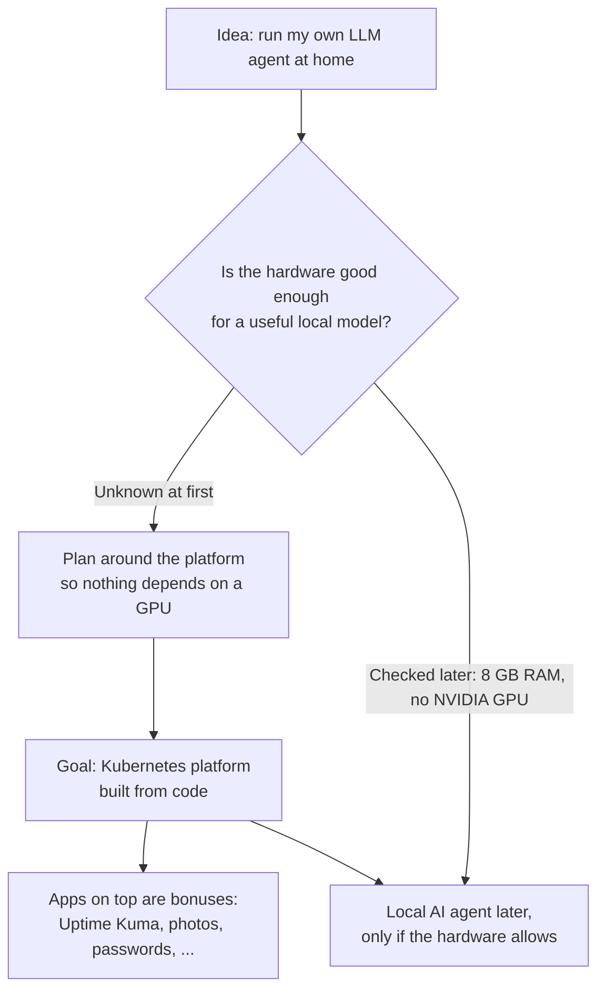

# Decisions: what we build and why

**Goal:** decide what to build and which tools to use, before touching any hardware.

[← Back to README](../README.md) · [Next: Phase 0, Prepare the USB stick →](00-prepare-usb.md)

---

## How the idea changed

The project started as *"run my own LLM agent at home and reach it from anywhere"*. While planning, it became clear that the interesting, lasting part is the **platform underneath**: a Kubernetes setup built entirely from code. The AI agent became an optional bonus.

---

## The decisions, and why

| Question | Decision | Why | Alternatives considered |
| --- | --- | --- | --- |
| Which Linux? | **Ubuntu Server LTS** | 5 years of free updates, best NVIDIA and Kubernetes support, most tutorials assume it | Fedora (new release about every 13 months), Omarchy (a desktop, not a server) |
| Desktop on the server? | **No**, server edition only | Saves RAM; everything is done from the Mac. A desktop can be added later with one command | Ubuntu Desktop |
| Single or multi-node Kubernetes? | **Multi-node, on one machine** | Real cluster behaviour for learning, without buying more hardware | Single-node K3s |
| How to get several nodes on one machine? | **k3d**: Kubernetes nodes as Docker containers | Light, fast, all Kubernetes. No separate VM layer | Proxmox with VMs (rejected: the goal is Kubernetes, not a hypervisor) |
| Remote access | **Cloudflare Tunnel + Cloudflare Access** | Free, no open router ports, login with MFA in front of everything | Tailscale, port forwarding (unsafe) |
| Configure the server | **Ansible** | The whole server setup in a file; re-runnable and rebuildable | Doing it by hand |
| Things outside the server | **OpenTofu** (open-source Terraform) | Cloudflare DNS and access rules as code | Clicking in the dashboard |
| Deploy apps | **Argo CD (GitOps)** | Git is the single source of truth; push a change and the cluster follows | `kubectl apply` by hand |
| Secrets in Git | **Sealed Secrets** | Secrets are encrypted so only the cluster can read them | GitHub Secrets (those are for CI, not for the cluster) |
| CI | **GitHub Actions** | Free checks on every push | – |
| Backups | **restic** to an external disk | Simple, encrypted, free | – |

### Is it all free?

Yes, all the software is free and open source. The only real costs:

- a domain name: about 100–150 kr a year
- electricity for a machine that is always on
- optional: a 16 GB RAM stick, and an external backup disk

---

## Tools explained in one line each

| Tool | In one line |
| --- | --- |
| **Docker** | Runs programs in isolated containers |
| **Kubernetes** | Runs and looks after many containers across several machines (nodes) |
| **k3d** | Runs a small Kubernetes (K3s) where each node is a Docker container |
| **Ingress / Traefik** | The front door that routes web requests to the right app |
| **TLS** | The encryption behind `https://` |
| **Ansible** | Describes how a server should be set up, then makes it so |
| **OpenTofu** | Describes cloud resources (like Cloudflare settings), then creates them |
| **Argo CD** | Watches the Git repo and makes the cluster match it |
| **Sealed Secrets** | Encrypts secrets so they are safe to store in Git |
| **CI/CD** | Automatic checks (CI) and automatic deployment (CD) on every change |
| **Backups** | Copies of data stored somewhere else, so a broken disk isn't the end |

---

## About the local AI agent

The long-term dream is a terminal agent, similar to Claude Code, running on a free open-source model on this server and reachable with `ssh` from any computer. The research showed:

- Open-source terminal agents exist (for example OpenCode and Aider) and can use local models through Ollama.
- Useful coding models need a graphics card with roughly 16–24 GB of video memory.
- This laptop has 8 GB of RAM and no NVIDIA GPU, so the agent waits until there is better hardware.

That is why the platform comes first.

---

**Done when:** the tools are chosen and the order of the phases is clear.
