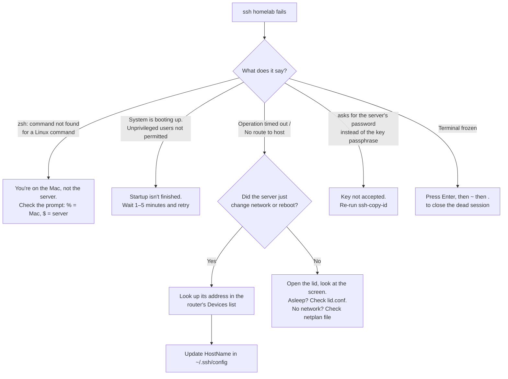

# Pitfalls and fixes

Every mistake, surprise and "wait, what?" moment so far, and how it was solved. If you're stuck, start with the flowchart.

[← Back to README](../README.md) · Guides: [Phase 0](00-prepare-usb.md) · [Phase 1](01-install-ubuntu.md) · [Phase 2](02-network-and-ssh.md)

---

## "I can't reach my server" flowchart

---

## All pitfalls so far

### Preparing

| # | Pitfall | What happened | Fix / lesson |
| --- | --- | --- | --- |
| 1 | **Rufus only runs on Windows** | All the prep was done on a Mac | Use **balenaEtcher** (or `dd`) on macOS |
| 2 | **Writing the installer to a disk with data** | I almost used my wife's 1 TB disk for the installer | The tool **erases the whole drive**. Use a cheap dedicated USB stick, and unplug every other drive |
| 3 | **"The disk is not readable" on the Mac** | macOS can't read the finished stick | Click **Ignore/Eject**, never **Initialize** |
| 4 | **Couldn't log in to Windows** | No password for the old Windows | Not needed: booting from USB skips Windows |

### Installing

| # | Pitfall | What happened | Fix / lesson |
| --- | --- | --- | --- |
| 5 | **No Ethernet cable** | Installer had no network | **Continue without network**; set up Wi-Fi after install |
| 6 | **Proxy and mirror screens** | Unsure what to enter | Proxy empty, mirror default |
| 7 | **Ubuntu Pro screen** | Unsure if needed | **Skip**; free to add later |
| 8 | **Only ~100G of a 238G disk used** | The installer leaves space free on purpose | Grow with `lvextend -r`; growing is safe, shrinking isn't. I added 80G and kept the rest for later |
| 9 | **Which name for the volume?** | `/dev/ubuntu-vg/ubuntu-lv` looked like magic | Check with `sudo lvs` or `lsblk` before running disk commands |
| 10 | **No "Installation complete" heading** | Only a Reboot Now button | The button only appears when it's done. Pull the stick when asked, then Enter |

### Networking and SSH

| # | Pitfall | What happened | Fix / lesson |
| --- | --- | --- | --- |
| 11 | **Didn't know the Wi-Fi password** | Needed it for the server | The Mac remembers it: System Settings → Wi-Fi → Details → Copy Password |
| 12 | **Vim instead of nano** | Guides often say nano | Any editor works. In Vim use `:set paste` before pasting indented YAML |
| 13 | **The `02-wifi.yaml` file didn't exist** | Only `00-installer-config.yaml` was there | You create it; Vim makes the file when you save |
| 14 | **Running Linux commands on the Mac** | `zsh: command not found: ip` | Check the prompt before each command |
| 15 | **"Deleted" SSH folder still full** | `~/.ssh` still had old keys and configs | Look before deleting: `ls -la ~/.ssh`, `cat ~/.ssh/config` |
| 16 | **SSH config pointing to missing keys** | Old hosts referred to deleted key files | Install the new key where needed before removing old ones |
| 17 | **Default vs custom key names** | `-f` changes the filename | With the default `id_ed25519`, SSH finds it automatically |

### Running a laptop as a server

| # | Pitfall | What happened | Fix / lesson |
| --- | --- | --- | --- |
| 18 | **Laptop sleeps when the lid closes** | The server would go offline | `lid.conf` with three `HandleLidSwitch...=ignore` lines |
| 19 | **A typo in `lid.conf`** | `HandleLidSwtichDocked` was **silently ignored** | Always `cat` a config file after writing it |
| 20 | **8 GB RAM, no GPU** | Not enough for a useful local LLM | Platform first; a 16 GB stick in the free slot brings it to 24 GB |

### The home network

| # | Pitfall | What happened | Fix / lesson |
| --- | --- | --- | --- |
| 21 | **The "router" was the mesh unit** | Admin page refused connections | `ip route show default` + `ip neigh` + a MAC vendor lookup identified the device |
| 22 | **Mesh ran its own network** | Server on `192.168.39.x`, main router on `192.168.1.x` | Connect the server **directly to the main router** |
| 23 | **Admin vs Wi-Fi password** | Two passwords on the router sticker | The admin page uses the **web admin** password, not the Wi-Fi one |
| 24 | **Simplified router view** | Settings missing | Switch to the advanced view |
| 25 | **SSH freezes when changing Wi-Fi** | The session ran over the network being changed | Expected. `Enter ~ .` closes it; find the new IP in the router |
| 26 | **"IP already in use" on a static lease** | The router warned and asked for a reboot | It's the server itself. Reboot the **server**, not the router |
| 27 | **Very slow first boot** | "System is booting up" for several minutes | Most likely waiting for the unused Ethernet port. To be fixed in Phase 4 |

---

## Golden rules learned so far

1. **Check where you are** (Mac `%` or server `$`) before every command.
2. **Look before you change**: `ls`, `cat`, `lsblk`, `lvs` only show things.
3. **Read back what you wrote**: `cat` the file. Typos fail silently.
4. **Don't delete what you don't understand** yet: find out what uses it first.
5. **Keep a way back in**: a second SSH session, or the server's own keyboard, when changing network or SSH settings.
6. **Never show secrets**: passwords, keys, router stickers, public IP.
